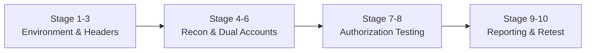

# Ethical Security Research Kit 🚀

> **The 10-Stage Framework for Ethical Bug Bounty Research & Authorization Audits**  
> Accelerate your security research workflow **10X faster** with ready-to-use Safe Harbor templates, Requestly configs, OWASP access control matrices, and remediation code patterns.

---

## 📌 Why This Kit Exists

Most security researchers spend hours setting up browsers, drafting reports from scratch, configuring headers, and organizing recon data. This kit provides a standardized, battle-tested structure designed for crowdsourced security platforms (such as **Intigriti**, **HackerOne**, and **Bugcrowd**).



---

## 🗂️ Repository Structure

```text
ethical-security-research-kit/
├── README.md                              # Methodology & 10-Stage Lifecycle Guide
├── config/
│   └── requestly_rules_template.json     # 1-Click Requestly import for Safe Harbor headers
├── templates/
│   ├── ACCESS_CONTROL_MATRIX.md           # OWASP ASVS v4.0 test execution matrix
│   └── VULNERABILITY_REPORT_TEMPLATE.md   # Platform-ready disclosure report with CVSS
├── scripts/
│   └── verify_header.sh                  # Terminal cURL script for quick header verification
└── src/
    └── secure_authorization_pattern.py    # Reference defensive code & runnable assertion suite
```

---

## ⚡ Quickstart (Get Ready in 2 Minutes)

### 1. Import Your Safe Harbor Header (Browser)
1. Install **Requestly** on Chrome/Firefox.
2. Import [`config/requestly_rules_template.json`](config/requestly_rules_template.json).
3. Replace `<YOUR_USERNAME>` with your platform handle. Your browser now automatically attaches:
   ```http
   X-Bug-Bounty: <Platform>-<Username>
   ```

### 2. Verify in Terminal
Run the verification script to confirm your identification header is accepted by the edge CDN:
```bash
chmod +x scripts/verify_header.sh
./scripts/verify_header.sh https://target.example.com "Platform-YourUsername"
```

### 3. Run the Defensive Code Self-Check
Demonstrate the before-and-after authorization fix locally (zero third-party dependencies required):
```bash
python3 src/secure_authorization_pattern.py
```

---

## 🗺️ The 10-Stage Ethical Research Roadmap

| Stage | Milestone | Purpose & Deliverable |
| :---: | :--- | :--- |
| **1** | **Target & Policy Selection** | Review in-scope domains and out-of-scope constraints on the bounty portal. |
| **2** | **Legal & Safe Harbor Setup** | Initialize a private tracking repository to maintain strict CVD confidentiality. |
| **3** | **Identity Calibration** | Configure custom identification headers across browser and CLI tools. |
| **4** | **Subdomain & Asset Mapping** | Probe edge CDNs, WAFs, and identify single-sign-on (SSO) identity providers. |
| **5** | **API Traffic & Schema Analysis** | Inspect public REST/GraphQL APIs, endpoints, and data contracts in DevTools. |
| **6** | **Dual-Account Provisioning** | Create User A (Attacker context) and User B (Victim context) using alias emails. |
| **7** | **Access Control Verification** | Execute cross-context access checks; populate [`templates/ACCESS_CONTROL_MATRIX.md`](templates/ACCESS_CONTROL_MATRIX.md). |
| **8** | **Minimal PoC Isolation** | Stop at single-record proof; strictly observe the "No Bulk Enumeration" rule. |
| **9** | **Remediation & Report Authoring** | Draft the disclosure report with CVSS scoring using [`templates/VULNERABILITY_REPORT_TEMPLATE.md`](templates/VULNERABILITY_REPORT_TEMPLATE.md). |
| **10** | **Triage & Retest Lifecycle** | Submit via platform; verify vendor patches within the 5–30 day retest window. |

---

## ⚖️ License & Ethical Standards

This repository is distributed under the **Apache-2.0 License**.  
All research must strictly comply with the target organization's Coordinated Vulnerability Disclosure (CVD) policy and platform rules of engagement.
